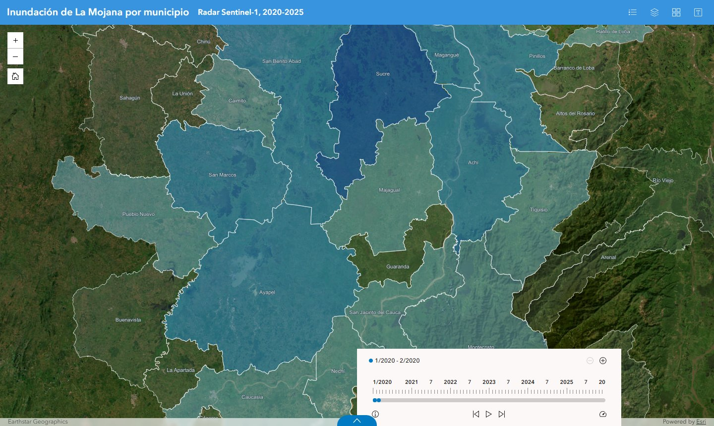
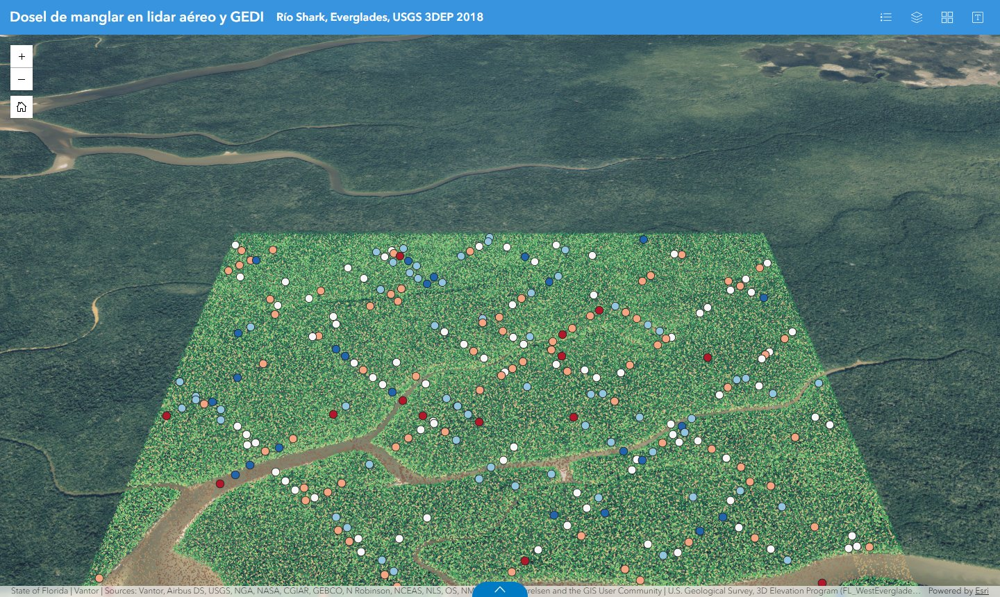

# ArcGIS Online Apps

ArcGIS Online and Experience Builder apps built from my remote sensing work, with the Python that prepares and publishes every layer: a time-enabled flood map of La Mojana (Colombia) and a 3D lidar point cloud scene of the Everglades mangroves (Florida).

## La Mojana flood by municipality

**App: https://experience.arcgis.com/experience/3c4c6877a8c448dcb378899b89a42cf3**

New flood water mapped every month from 2020 to 2025 with Sentinel-1 radar in La Mojana, northern Colombia, before and after the Cara de Gato dike on the Cauca River broke in August 2021, summed for each of the 30 municipalities in the area. A time slider steps the map month by month and a chart shows the total for the whole area.



### Results

At the December 2022 peak, 1,575 km² of new flood water:

| Municipality | Department | New flood (km²) | Share of the area's flood | Share of the municipality inside the area |
|---|---|---|---|---|
| San Benito Abad | Sucre | 394 | 25% | 32% |
| Sucre | Sucre | 387 | 25% | 35% |
| Ayapel | Córdoba | 181 | 11% | 9% |
| San Marcos | Sucre | 166 | 11% | 19% |
| Pinillos | Bolívar | 149 | 9% | 26% |

**Preregistered expectation not met.** Written before computing ([PREREGISTRATION.md](PREREGISTRATION.md)): more than half of the peak flood would lie in Guaranda, Majagual, Sucre and San Jacinto del Cauca, the municipalities on the left bank of the Cauca downstream of the breach. They held 27% (27.0% at −16 dB, 28.9% at −20 dB). Most of the peak flood lay further north and west, in San Benito Abad, Sucre, Ayapel and San Marcos (72% together).

**Check.** The municipal areas of each month add up to the area total of [Mojana-flood-SAR](https://github.com/linaq11/Mojana-flood-SAR) within 0.012% at −18 dB (preregistered limit: 1%). Leaving one municipality out (Majagual) raises the difference to 5.5%.

### Method

* **Flood.** The monthly flood maps of Mojana-flood-SAR, unchanged: Sentinel-1 VV below −18 dB in the monthly median, slope of 5° or less, not permanent water (JRC occurrence of 90% or more), and not water in at least half of the months from January 2020 to July 2021. −16 and −20 dB are kept as a sensitivity check.
* **Municipalities.** DANE, Marco Geoestadístico Nacional 2025, read from DANE's public service. El Roble (Sucre) touches the edge of the area without any surface inside and is left out.
* **Area.** Earth Engine pixel areas at 30 m inside each municipality and the study area (75.3° W to 74.3° W, 7.9° N to 9.0° N).
* **ArcGIS Online.** A file geodatabase with real date fields and Spanish aliases, published as one hosted feature layer (municipalities, municipalities by month with time enabled, and the monthly series); a web map with a class-breaks renderer, Arcade pop-ups and a one-month time window; and an Experience Builder app with a timeline, a chart of the series and a method panel.

### Reproduce

```bash
python scripts/fetch_municipalities.py                                   # DANE municipalities, data/municipios_mgn2025.geojson
python scripts/municipal_flood.py --project <your-earth-engine-project>  # data/municipal_monthly.csv
python scripts/build_layers.py                                           # agol/*.geojson and the monthly series
# with ArcGIS Pro's Python, signed in to ArcGIS Online in ArcGIS Pro:
python scripts/make_fgdb.py                                              # agol/mojana_inundacion.gdb(.zip)
python scripts/publish_agol.py                                           # hosted feature layer, private
python scripts/make_webmap.py <feature-service-item-id>                  # web map
```

The Experience Builder app was assembled in the Experience Builder editor; it is not scripted.

### Limits

* Same as the flood maps: radar misses water under flooded vegetation, and a rainy season larger than those of 2020 and 2021 would also count as new flood.
* Municipal figures cover only the part of each municipality inside the study area.

## Mangrove canopy in airborne lidar and GEDI, Everglades

**App: https://experience.arcgis.com/experience/7155019c6d364d949bdc9c0824d93759**

The USGS 3DEP airborne lidar of 2018 over the Shark River mangroves in Everglades National Park, Florida, as a 3D point cloud scene layer, with the 520 GEDI shots of the preregistered comparison in [lidar-mangrove-canopy](https://github.com/linaq11/lidar-mangrove-canopy) drawn at the height GEDI measured.



* **Point cloud.** 330 million points in a 2.3 by 2.3 km window, the one shown in the lidar dashboard, coloured by height. The noise classes (7, low noise, and 18, high noise, with points up to 533 m) are left out because they would draw as false spikes.
* **GEDI shots.** GEDI L2A, 2019 to 2025. Each circle floats at the shot's RH98 above the ground and is coloured by RH98 minus the lidar's 98th percentile in the same 12.5 m footprint, blue where GEDI is lower and red where it is higher.
* **Result** (from lidar-mangrove-canopy): bias of −0.13 m and RMSE of 1.86 m for beam sensitivity of 0.95 to 0.98 (329 shots), and +0.08 m and 1.86 m for 0.98 or more (191 shots); the difference in absolute bias, 0.04 m, had a 95% interval of −0.26 to 0.26 m, so no difference was detected.
* **ArcGIS.** The points are cut from the cached EPT nodes into 500 m UTM 17N LAZ tiles, packaged in ArcGIS Pro as a point cloud scene layer package (2.8 GB) and published as a scene layer; the GEDI shots are a hosted feature layer; the web scene and the app hold both.

```bash
python ../lidar-mangrove-canopy/scripts/export_scene_tiles.py --cache <ept cache> --out <tiles>   # LAZ tiles
# with ArcGIS Pro's Python:
python scripts/make_lidar_scene.py --tiles <tiles> --work <work folder>                         # LAS dataset and .slpk
python scripts/make_lidar_webscene.py <scene-service-id> <scene-package-id>                     # web scene
python scripts/publish_gedi_shots.py ../lidar-mangrove-canopy/data/gedi_vs_lidar.csv <web-scene-id>
```

The upload of the 2.8 GB package failed through the ArcGIS API for Python ("Failed to upload all parts") and was done with ArcGIS Pro's Share Package tool instead.

## Credits

Radar: Copernicus Sentinel-1 (ESA). Permanent water: JRC Global Surface Water (Pekel et al., 2016). Municipalities: DANE, Marco Geoestadístico Nacional 2025. Airborne lidar: U.S. Geological Survey, 3D Elevation Program (FL_WestEvergladesNP 2018). GEDI: NASA, GEDI L2A. Basemap: Esri World Imagery.

Lina María Quintero Fonseca, geographer, MSc student in Geomatics at the Universidad Nacional de Colombia. Code under the MIT License; to cite, use `CITATION.cff`.
